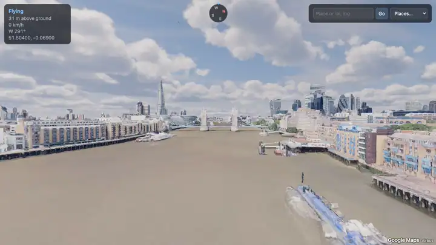
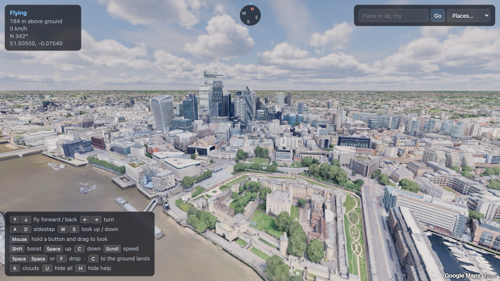
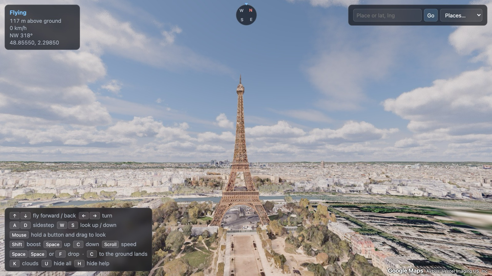
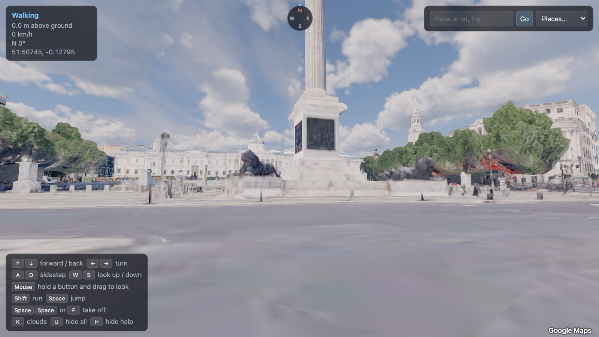

# Walk & Fly — Google 3D

Walk the streets or fly like a bird through Google's photorealistic 3D world, in your browser.

Google Maps' own 3D view keeps you in a bird's-eye orbit. This app loads the same 3D buildings, trees and terrain and lets you go anywhere: stand in Trafalgar Square, skim the Thames, or climb above the clouds over Paris.



<sub>A 15-second flight recorded in the app. [Full-quality video](docs/flythrough.mp4).</sub>



| | |
| --- | --- |
|  |  |
| Flying over Paris | On foot in Trafalgar Square |

<sub>Imagery: Google, Airbus and the other providers credited in the app.</sub>

## What you need

- [Node.js](https://nodejs.org) 20 or newer.
- A Google Maps Platform API key. Each person uses their own; there is no shared key.
- A reasonably recent computer. The clouds are demanding; press `K` to turn them off.

## Get it running

### 1. Get a Google API key

1. Open the [Google Cloud Console](https://console.cloud.google.com/) and create a project (or pick one).
2. Set up billing on the project. Google requires a billing account even for free usage.
3. Go to [APIs & Services → Library](https://console.cloud.google.com/apis/library), search for **Map Tiles API** and enable it.
4. Go to [APIs & Services → Credentials](https://console.cloud.google.com/apis/credentials), choose **Create credentials → API key** and copy the key.
5. Recommended: edit the key and restrict it.
   - **API restrictions:** Map Tiles API only.
   - **Application restrictions:** Websites, with `http://localhost:5173/*`.

### 2. Run the app

```bash
git clone <this repository's URL>
cd google-maps-walk-and-fly
npm install
cp .env.example .env.local
```

Open `.env.local`, paste your key after `VITE_GOOGLE_MAPS_API_KEY=`, then:

```bash
npm run dev
```

Open <http://localhost:5173>. You start in the air above the Tower of London.

`.env` and `.env.local` are ignored by git, so your key is never committed.

### What it costs

Google bills Map Tiles usage to the owner of the key. There is a free monthly allowance, and normal exploring uses it slowly, but check [Google's pricing](https://developers.google.com/maps/billing-and-pricing/pricing) and consider setting a budget alert or a daily quota on the key. The Map Tiles API is not available to every billing region; if tiles fail to load, the app shows Google's error.

## Controls

The right hand rests on the arrow keys, the left on W A S D, Space and C. The mouse is optional.

| Key | Walking | Flying |
| --- | --- | --- |
| ↑ ↓ | forward / back | fly forward / back along where you look; let go to stop |
| ← → | turn | turn (the view banks) |
| A D | sidestep | sidestep |
| W S | look up / down | pitch up / down |
| Mouse, button held | drag to look around | drag to look around |
| Shift | run | boost |
| Space | jump | climb |
| C | – | descend; touching the ground lands you |
| Space twice, or F | take off | drop to the ground |
| Scroll | – | change flying speed |
| K | clouds on / off | same |
| H | hide / show the help panel | same |
| U | hide / show the whole interface | same |

Flying speed grows with height, so you can thread streets down low and cross a city up high.

### Going places

Use the box at the top right to pick a preset city or type `latitude, longitude` (pasting a Google Maps link also works). The address bar keeps your position, so reloading or sharing the link returns to the same spot.

To search by place name as well, also enable the **Maps JavaScript API** and **Geocoding API** on your key (and add them to its API restrictions). Without them the box still accepts coordinates.

## Limits worth knowing

- **Street level is rough.** Google builds this mesh from aerial photos. It looks great from the air; up close, buildings are soft and trees are solid lumps.
- **Coverage is Google's.** Most large cities are in 3D. Elsewhere you get flat satellite-textured terrain, and a few sensitive sites are deliberately flattened.
- **Lighting is fixed.** One mid-afternoon sun everywhere; there is no night.
- **One texture is fetched from GitHub.** The cloud renderer's noise texture loads from the three-geospatial project's host; everything else is served locally or by Google.

## Putting it online

If you host this, your key ships inside the page and every visitor's usage is billed to you. Restrict the key to your domain, set a quota, and replace the "Google Maps" text attribution with Google's official logo from the [Map Tiles API policies](https://developers.google.com/maps/documentation/tile/policies), which also set out the attribution rules you must follow.

## How it works

- `src/world.ts` streams Google Photorealistic 3D Tiles with [3d-tiles-renderer](https://github.com/NASA-AMMOS/3DTilesRendererJS) and keeps your surroundings at the scene origin with +Y up, re-anchoring every kilometre so it works anywhere on Earth.
- `src/player.ts` is the walk and fly controller. Collision is done by casting rays against the loaded tile meshes.
- `src/atmosphere.ts` adds the sky, sunlight, haze and volumetric clouds with [three-geospatial](https://github.com/takram-design-engineering/three-geospatial).
- `src/hud.ts` and `src/main.ts` hold the interface and the render loop.

Built with [three.js](https://threejs.org), [Vite](https://vite.dev) and TypeScript. `npm run build` type-checks and produces a static site in `dist/`.

## Licence

The code is released under the [MIT licence](LICENSE). The map data is Google's and its providers', used under the [Google Maps Platform terms](https://cloud.google.com/maps-platform/terms); it is not covered by this licence.
